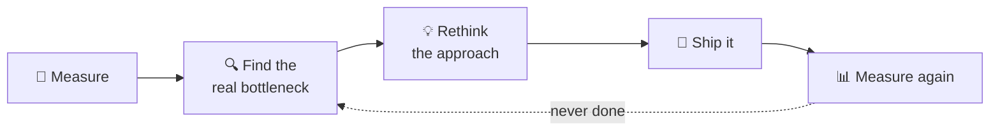
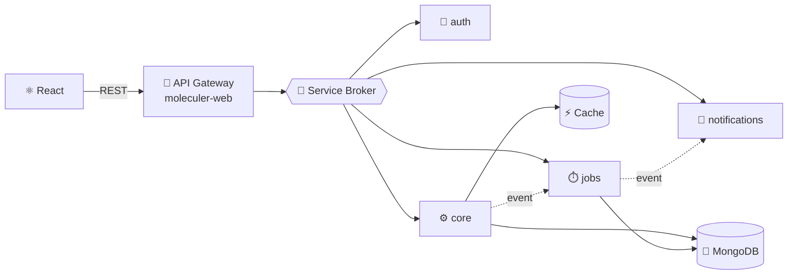

<!-- ───────────────────────────── HEADER ───────────────────────────── -->
<picture>
  <source media="(prefers-color-scheme: dark)" srcset="https://capsule-render.vercel.app/api?type=waving&height=230&color=0:020617,55:0F172A,100:1D4ED8&text=Javier%20Valenzuela&fontColor=F8FAFC&fontSize=52&fontAlignY=36&desc=I%20optimize%20systems%20%C2%B7%20I%20build%20what%27s%20missing&descSize=17&descAlignY=58&animation=fadeIn&section=header"/>
  
</picture>

<div align="center">

<a href="https://dev-tymo.vercel.app">
  
</a>

<br/>

<a href="https://dev-tymo.vercel.app"></a>
<a href="https://www.linkedin.com/in/TU_LINKEDIN"></a>


</div>

<br/>

<!-- ───────────────────────────── WHOAMI ───────────────────────────── -->

```js
mol $ call developer.whoami

>> Call 'developer.whoami'
>> Response:
{
  name:       "Javier Iván Valenzuela Esparza",
  alias:      "tymo",
  basedIn:    "Tijuana, BC 🇲🇽",
  role:       "Software Developer",
  dailyStack: ["Node.js", "TypeScript", "Moleculer", "MongoDB", "React"],
  superpower: "finding the bottleneck nobody looked at",
  habit:      "if the tool doesn't exist, I build it"
}
>> Execution time: 3ms
```

I'm a developer who gets bored with "it works". I like **taking a system apart, finding where it wastes time or resources, and rebuilding it leaner**: fewer queries, less memory, faster responses, simpler code.

And when a problem has no good solution yet, I **create one**: from microservices in production to ML models, AI tooling and full products built from scratch.

<br/>

<!-- ───────────────────────────── APPROACH ───────────────────────────── -->

## 🔁 How I attack a problem



No guessing. Profile first, fix what actually hurts, prove it with numbers, repeat.

<details>
<summary><b>🛠️ My optimization toolkit</b></summary>

<br/>

| Layer | What I tune |
|:--|:--|
| **Database** | MongoDB indexes, aggregation pipelines, projections, avoiding N+1 calls |
| **Services** | Moleculer actions & events, caching, async work off the hot path, smaller payloads |
| **Frontend** | React re-renders, memoization, lazy loading, lighter bundles |
| **Code** | Removing duplication, simpler abstractions, logic that's easy to test and change |

</details>

<br/>

<!-- ───────────────────────────── ARCHITECTURE ───────────────────────────── -->

## 🧩 How I design systems

Small services with one job each, talking through a broker and reacting to events instead of blocking each other.



<br/>

<!-- ───────────────────────────── STACK ───────────────────────────── -->

## ⚡ Stack

<table>
<tr>
<td width="33%" align="center" valign="top">

**Daily driver**


</td>
<td width="33%" align="center" valign="top">

**Also ship with**


</td>
<td width="33%" align="center" valign="top">

**Leveling up**


<sub>distributed systems · observability · CI/CD</sub>

</td>
</tr>
</table>

<br/>

<!-- ───────────────────────────── PROJECTS ───────────────────────────── -->

## 🚀 Things I've built

<table>
<tr>
<td width="50%" valign="top">

### ☕ BrewHub
<sub><a href="https://github.com/BrewHub-Dev">BrewHub-Dev</a> · full product, three codebases</sub>

A complete platform built from zero: a TypeScript engine on **Fastify + Bun** (Dockerized, with tests), a web client and a mobile app.

<a href="https://github.com/BrewHub-Dev/brewhub-engine"></a>
<a href="https://github.com/BrewHub-Dev/brewhub-app"></a>
<a href="https://github.com/BrewHub-Dev/brewhub-movil"></a>

</td>
<td width="50%" valign="top">

### ⚙️ Production microservices
<sub>Professional work · private code</sub>

Building new services and optimizing existing ones on a **Moleculer + MongoDB** platform that runs every day in production.

`Moleculer` `Node.js` `MongoDB` `React`

</td>
</tr>
<tr>
<td width="50%" valign="top">

### ⚽ predictor-service
<sub>Machine learning microservice</sub>

Football match predictions combining a **Dixon–Coles Poisson** model with a **Gradient Boosting** ensemble, ranking results by expected value. Clean architecture, built to plug in new leagues.

`Python` `FastAPI` `scikit-learn`

</td>
<td width="50%" valign="top">

### 🤖 AI Job Hunter
<sub>AI tooling</sub>

A monorepo that discovers job postings, scores how well they match a profile and decides what to apply to, with separate discovery, matching and decision engines.

`FastAPI` `Next.js` `Clean Architecture`

</td>
</tr>
<tr>
<td width="50%" valign="top">

### 🌐 dev.tymo
<sub><a href="https://dev-tymo.vercel.app">dev-tymo.vercel.app</a></sub>

My portfolio, organized by features with shared UI components.

<a href="https://github.com/JavierIvanValenzuelaEsparza/dev.tymo"></a>
`Next.js` `TypeScript` `Tailwind`

</td>
<td width="50%" valign="top">

### 📊 client-insights
<sub><a href="https://client-insights.vercel.app">client-insights.vercel.app</a></sub>

Web app for exploring client data and insights.

<a href="https://github.com/JavierIvanValenzuelaEsparza/client-insights"></a>
`Next.js` `TypeScript`

</td>
</tr>
</table>

<br/>

<!-- ───────────────────────────── PRINCIPLES ───────────────────────────── -->

## 🧠 What I believe

| | |
|:--|:--|
| **Measure before optimizing** | A guess is not a fix. Profiling tells me where the time actually goes. |
| **The best code is the code you delete** | Simpler usually means faster, cheaper and easier to change. |
| **If it doesn't exist, build it** | Some of my favorite projects started as "why isn't there a tool for this?" |
| **Leave it better than I found it** | Every change should make the next one easier. |

<br/>

<!-- ───────────────────────────── STATS ───────────────────────────── -->

## 📈 Activity

<div align="center">


<br/><br/>

<picture>
  <source media="(prefers-color-scheme: dark)" srcset="https://raw.githubusercontent.com/JavierIvanValenzuelaEsparza/JavierIvanValenzuelaEsparza/output/github-snake-dark.svg"/>
  
</picture>

</div>

<br/>

<!-- ───────────────────────────── NOW ───────────────────────────── -->

## 🔭 Right now

- ⚡ Squeezing more performance out of microservices in production
- ☕ Building BrewHub end to end
- 🌱 Going deeper on distributed systems, observability and Go

<br/>

<div align="center">

```js
mol $ emit developer.contact { reason: "a problem worth solving" }
>> Event 'developer.contact' emitted. I usually answer fast. ⚡
```

<a href="https://dev-tymo.vercel.app"></a>
<a href="https://www.linkedin.com/in/TU_LINKEDIN"></a>

</div>

<picture>
  <source media="(prefers-color-scheme: dark)" srcset="https://capsule-render.vercel.app/api?type=waving&height=110&section=footer&color=0:1D4ED8,45:0F172A,100:020617"/>
  
</picture>
